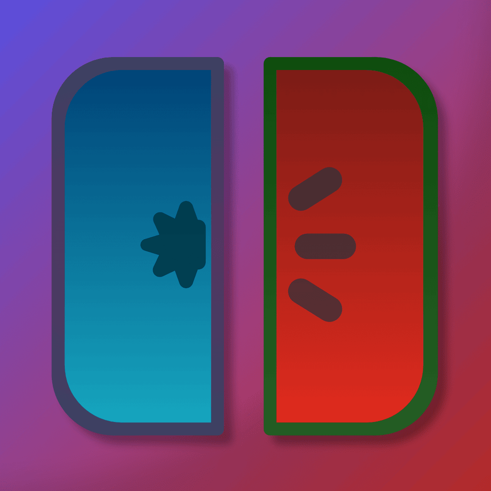

<p align="center">
  
</p>

<h1 align="center">Meliora</h1>

<p align="center">
  A Nintendo Switch emulator for iPhone and iPad, focused on cleanup, stability and optimization.<br>
  Based on <a href="https://github.com/VertexSelection/MeloVertex">MeloVertex</a>, which is based on MeloNX, which is based on Ryujinx.
</p>

**Version 0.0.2**, see the [changelog](CHANGELOG.md) for what is different from MeloVertex and what the stability pass fixed.

> **Unofficial project.** Meliora is an independent fork. It is **not affiliated with** the MeloNX team, the MeloVertex author or the Ryujinx project. Please do not ask them for support with Meliora.

## About the name

```
Name:       Meliora
Meaning:    "better" in Latin
Why:        fork of MeloNX focused on cleanup and optimization
Connection: shared Mel- root
Tone:       mature, not aggressive
```

The name states the goal plainly: keep what works, remove what does not, and make it a little better with every release. It builds on other people's work and says so openly (see [Credits](#credits)).

## Requirements

- **JIT is required.** Meliora cannot run without it. On iOS 26, [StikDebug](https://github.com/StephenDev0/StikDebug) is the supported way to enable it.
- The **Increased Memory Limit** entitlement is required on all devices. The app warns you if it is missing.
- Recommended hardware (inherited from upstream documentation, not re-measured for Meliora): iPhone 15 Pro or newer, iPad Pro 5th generation or newer, or iPad Air 5 or newer.
- **Extended Virtual Addressing** is only needed on devices with little RAM (iPhones under 4 GB, iPads under 8 GB). It requires a paid developer account or TrollStore, so a separate IPA is provided for it.

## Install

1. Download the latest IPA from [Releases](../../releases). Two variants are published:
   - `Meliora-<version>.ipa`: Increased Memory Limit. Use this one unless you know you need the other.
   - `Meliora-<version>-extended-va.ipa`: adds Extended Virtual Addressing.
2. The IPA is **unsigned**. Sign and install it with your own Apple ID using a sideloader such as AltStore, SideStore, Sideloadly or Plume Impactor.
3. Open Meliora and add your **keys and firmware** with the in-app file picker.
4. Enable **JIT** (StikDebug), then add your games and play.

Some sideloaders and account types need the memory entitlement enabled separately. If Meliora reports it as missing, check your sideloader's documentation for how to add *Increased Memory Limit* to the App ID, then reinstall.

## Your own games only

Meliora ships with **no** games, keys or firmware, and will never help you obtain them. Use files dumped from your own Switch, which needs to run custom firmware for dumping:

- Hacking guide: <https://nh-server.github.io/switch-guide/>
- Dumping [keys](https://git.ryujinx.app/ryubing/ryujinx/-/wikis/Dumping/Keys), [games, updates and DLC](https://git.ryujinx.app/ryubing/ryujinx/-/wikis/Dumping/Games,-Updates-&-DLC) and [firmware](https://git.ryujinx.app/ryubing/ryujinx/-/wikis/Dumping/Firmware)

## Reporting performance problems

Meliora writes a `[Meliora] mem ...` line to its log every 10 seconds (memory footprint, memory still available, thermal state, FPS). When a game lags or crashes, open the in-app log and attach those lines to your issue. They show whether the cause is memory, heat or something else.

## Build it yourself

**Without a Mac:** fork this repository and run the **Build iOS IPA** workflow in the *Actions* tab. It builds the emulator core and the app on a GitHub macOS runner and uploads the IPAs as an artifact. Pushing a `v*` tag also publishes them as a release. If you fork Meliora, update the support link in `ContentView.swift` to your own repository.

**On a Mac:** see [Compile.md](Compile.md).

## Documentation

- [CONTRIBUTING.md](CONTRIBUTING.md) — how to open issues and pull requests.
- [Compile.md](Compile.md) — building the app and the core on a Mac.
- [docs/coding-guidelines/coding-style.md](docs/coding-guidelines/coding-style.md) — C# coding style.
- [docs/workflow/pr-guide.md](docs/workflow/pr-guide.md) — pull request workflow.
- [docs/README.md](docs/README.md) — architecture notes inherited from Ryujinx.

## Credits

Meliora exists because of other people's work:

- **Ryujinx** and all its contributors: the Nintendo Switch emulator everything here is built on.
- **MeloNX** by Stossy11 and contributors: the iOS port of Ryujinx (Swift app, JIT and memory handling, Metal/MoltenVK integration).
- **MeloVertex** by VertexSelection: the direct upstream of this fork. According to its README it fixes the keyboard and a first-setup hang and adds Tomodachi Life support. Meliora continues from its 2.4.5 source.

Third-party components (SDL2, MoltenVK, FFmpeg libraries, libteakra, Swift packages) and their licenses are listed in [NOTICE.md](NOTICE.md).

## License

Meliora is licensed under **AGPL-3.0** (full text in [LICENSE.txt](LICENSE.txt)); the Swift app layer carries the MeloNX License, and Ryujinx code is MIT — see [LICENSE.txt](LICENSE.txt) and [NOTICE.md](NOTICE.md) for the exact terms and third-party attributions.

---

Maintained by [@Quancore21](https://github.com/Quancore21).
